# Pull Requests Notifier

Aplicativo leve para **Windows** que fica na bandeja do sistema (perto do relógio) e **avisa na hora** quando algo acontece nos seus **Pull Requests do Azure DevOps** (Server/TFS e Services/Cloud): comentário novo, voto de revisor, conflito de merge, build que falhou, PR pronto para merge e mais.

Você não precisa ficar com a página de PRs aberta nem atualizando o navegador. O app consulta o Azure DevOps de tempos em tempos, compara com o que viu antes e mostra uma notificação elegante só do que mudou.

  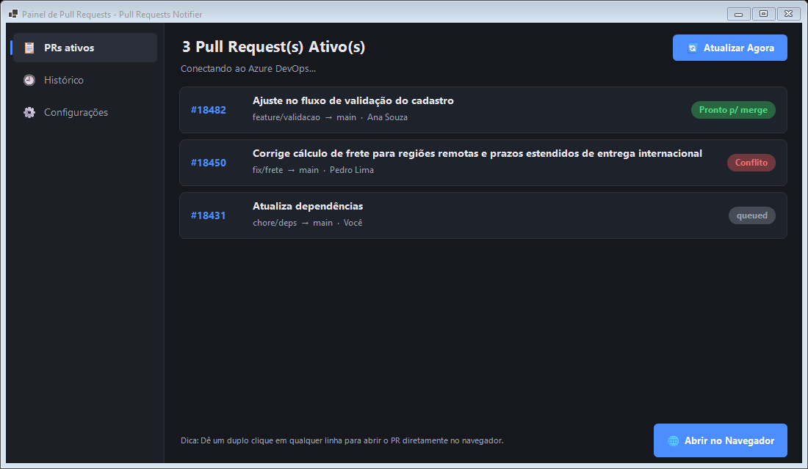

## Sumário

- [Destaques](#destaques)
- [Como funciona](#como-funciona)
- [Requisitos](#requisitos)
- [Instalação passo a passo](#instalação-passo-a-passo)
- [Primeira configuração](#primeira-configuração)
- [Uso no dia a dia](#uso-no-dia-a-dia)
- [Referência de todas as opções](#referência-de-todas-as-opções)
  - [Aba Conexão](#aba-conexão)
  - [Aba Notificações](#aba-notificações)
  - [Aba Eventos a Notificar](#aba-eventos-a-notificar)
  - [Aba Sistema & Tema](#aba-sistema--tema)
- [Estilos visuais](#estilos-visuais)
- [Como são os alertas na tela](#como-são-os-alertas-na-tela)
- [Atualizações automáticas](#atualizações-automáticas)
- [Onde ficam seus dados e segurança](#onde-ficam-seus-dados-e-segurança)
- [Solução de problemas](#solução-de-problemas)
- [Desinstalar](#desinstalar)
- [Limitações conhecidas](#limitações-conhecidas)

---

## Destaques

- **Notificações na tela** modernas, que não roubam o foco do que você está digitando, com som opcional.
- **Mais de dez tipos de evento**, ligados ou desligados um a um: comentários, menções, votos, conflitos, builds, novos commits, novos PRs e outros.
- **Agrupamento inteligente**: vários eventos de uma vez viram um único resumo, em vez de uma enxurrada de pop-ups.
- **Painel de PRs** com carregamento instantâneo e **histórico** dos alertas recebidos.
- **3 estilos visuais × tema claro e escuro** (6 aparências), com a navegação mudando de lugar conforme o estilo.
- **Português e Inglês**, trocáveis a qualquer momento.
- **Somente leitura**: o app só consulta o Azure DevOps, nunca altera nada nos seus PRs.
- **Atualização automática**: avisa quando há versão nova e atualiza com um clique.
- **Seguro**: o token de acesso (PAT) é guardado criptografado, vinculado ao seu usuário do Windows.

## Como funciona

1. A cada **15 segundos** (configurável de 10 a 600) o app pergunta ao Azure DevOps quais são os Pull Requests ativos do repositório que você escolheu.
2. Ele separa os PRs que importam para você: os que **você criou** e/ou aqueles em que **você é revisor**.
3. Para cada um, lê os comentários (tópicos), os status de validação (builds, SonarQube etc.) e os votos dos revisores.
4. Compara com o que viu na rodada anterior. **A primeira leitura depois de abrir o app serve só de referência** e não gera alertas; daí em diante, qualquer diferença vira um evento.
5. Cada evento passa pelos filtros que você ligou na aba **Eventos a Notificar** e vira uma notificação, com som se você quiser, e entra no **histórico**.

Se a rede cair (VPN, por exemplo) ou o servidor responder com erro, o app **não perde o que já sabia**: ele só tenta de novo na rodada seguinte e mostra o problema no menu da bandeja. Quando a conexão volta, não aparece uma avalanche de alertas falsos.

> O app usa apenas requisições de **leitura** (`GET`) à API REST do Azure DevOps. Ele não aprova, não comenta e não altera PRs.

## Requisitos

| Item | Requisito |
|---|---|
| Sistema | Windows 10 ou 11, 64 bits |
| .NET | **.NET 9 Desktop Runtime**. O instalador baixa e instala sozinho se você não tiver. |
| Azure DevOps | Azure DevOps Server (TFS on-premises) ou Azure DevOps Services (nuvem) |
| Acesso | Um **Personal Access Token (PAT)** seu, com permissão de leitura de código (veja abaixo) |
| Rede | Alcance até o servidor do Azure DevOps (VPN, se for o caso) e acesso à internet para as atualizações |

> O app foi validado principalmente com **Azure DevOps Server**. Para o Azure DevOps Services (nuvem) use a configuração indicada em [Primeira configuração](#2-descobrir-os-dados-da-conexão); ela segue o mesmo formato de endereço da API.

## Instalação passo a passo

1. Abra a página de [**Releases**](../../releases/latest) deste repositório.
2. Em **Assets**, baixe **`PRNotifier-win-Setup.exe`**.
3. Dê um duplo clique no arquivo. A instalação é **por usuário**: não pede senha de administrador e leva poucos segundos. Se faltar o .NET 9 Desktop Runtime, o instalador o instala junto.
4. Ao terminar, o app abre sozinho e o ícone aparece na **bandeja do sistema** (se não estiver à vista, clique na setinha **^** perto do relógio). Na primeira vez, a janela de **Configurações** abre automaticamente.

### Aviso "O Windows protegeu o computador"

O instalador não tem assinatura digital paga, então o Windows SmartScreen pode mostrar essa tela na primeira execução. Clique em **Mais informações** e depois em **Executar assim mesmo**. Isso acontece só na instalação.

## Primeira configuração

Você precisa de quatro informações do seu Azure DevOps e de um token.

### 1. Criar o Personal Access Token (PAT)

1. No Azure DevOps, clique no ícone de usuário no canto superior direito e vá em **Personal access tokens** (ou **Security → Personal access tokens**).
2. Clique em **New Token**.
3. Dê um nome (por exemplo, `Pull Requests Notifier`) e escolha a validade.
4. Em **Scopes**, marque **Code → Read** (leitura de código). Isso basta para ler PRs, comentários e status.
5. Crie e **copie o token**: ele só é mostrado uma vez.

> Quando o token expirar, o app passa a mostrar "Falha ao autenticar" no menu da bandeja. Gere um novo e cole em Configurações.

### 2. Descobrir os dados da conexão

O endereço de um PR no navegador mostra tudo o que você precisa. Veja os dois formatos:

| Tipo | Endereço de um PR | URL do Servidor | Coleção / Organization | Projeto | Repositório |
|---|---|---|---|---|---|
| **Azure DevOps Server (TFS)** | `https://devops.exemplo.com:8081/DefaultCollection/MeuProjeto/_git/MeuRepo/pullrequest/123` | `https://devops.exemplo.com:8081` | `DefaultCollection` | `MeuProjeto` | `MeuRepo` |
| **Azure DevOps Services (nuvem)** | `https://dev.azure.com/minhaorg/MeuProjeto/_git/MeuRepo/pullrequest/123` | `https://dev.azure.com` | `minhaorg` (o nome da organização) | `MeuProjeto` | `MeuRepo` |

### 3. Preencher e testar

1. Na aba **Conexão**, preencha **URL do Servidor**, **Coleção / Organization**, **Projeto**, **Repositório** e **PAT**.
2. Clique em **Testar Conexão**. Se tudo estiver certo, aparece **"Conectado: seu nome!"** em verde.
3. (Opcional) Passe pelas outras abas para ajustar som, eventos e visual.
4. Clique em **Salvar e Monitorar**. O monitoramento começa na hora.

  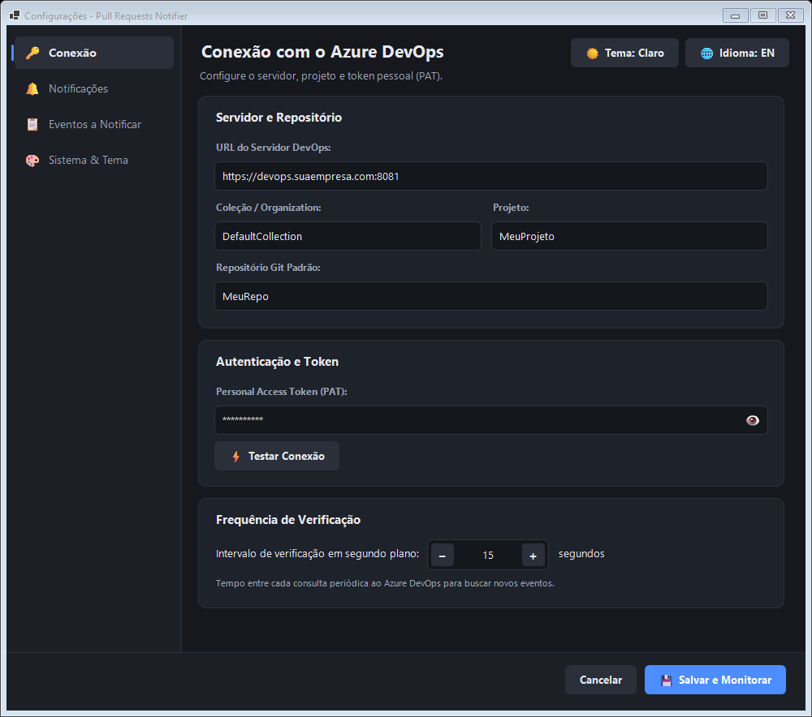

## Uso no dia a dia

### O ícone da bandeja

Clique com o **botão direito** no ícone para abrir o menu. Um **duplo clique** abre o painel de PRs.

  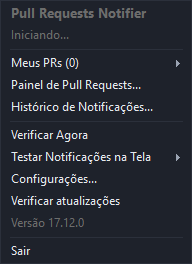
  &nbsp;&nbsp;
  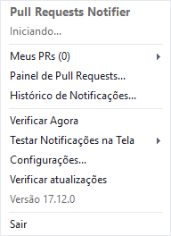

| Item do menu | Para que serve |
|---|---|
| Linha de status | Mostra o que o app está fazendo: "Conectando...", "Atualizado às 14:32 (3 PRs)", "Falha ao autenticar" etc. |
| **Meus PRs (n)** | Submenu com seus PRs ativos. Clicar em um abre o PR no navegador. PRs com conflito aparecem com ⚠️. |
| **Painel de Pull Requests...** | Abre o painel com a lista completa. |
| **Histórico de Notificações...** | Abre o painel já na página do histórico. |
| **Verificar Agora** | Consulta o Azure DevOps imediatamente, sem esperar o próximo ciclo. |
| **Testar Notificações na Tela** | Mostra um alerta individual e um alerta agrupado de exemplo, para você ver como ficam com suas configurações. |
| **Configurações...** | Abre a janela de configurações. |
| **Verificar atualizações** | Procura uma versão nova do app. |
| Versão | Mostra a versão instalada. |
| **Sair** | Fecha o app. |

### O painel de Pull Requests

O painel tem uma **navegação** (que muda de lugar conforme o estilo escolhido) com três destinos: **PRs ativos**, **Histórico** e **Configurações**.

**PRs ativos.** Cada linha mostra o número do PR, o título, `branch de origem → branch de destino · autor` e uma **etiqueta de situação**:

| Etiqueta | Significado |
|---|---|
| 🟢 **Pronto p/ merge** | Sem conflitos de merge. |
| 🔴 **Conflito** | O PR tem conflitos que precisam ser resolvidos. |
| ⚪ outra (ex.: `queued`) | O Azure DevOps ainda está calculando o merge. |

Um **duplo clique** (ou **Enter**) na linha abre o PR no navegador. O botão **Abrir no Navegador** faz o mesmo com a linha selecionada. **Atualizar Agora** (no topo) força uma consulta; se já houver uma em andamento, ele espera ela terminar.

**Histórico.** Lista os alertas que o app emitiu (os 200 mais recentes, do mais novo ao mais antigo), com horário, título, primeira linha da mensagem e o número do PR. Duplo clique abre o PR relacionado. **Limpar Histórico** esvazia a lista. O histórico fica só na memória: ao fechar o app ele é zerado.

  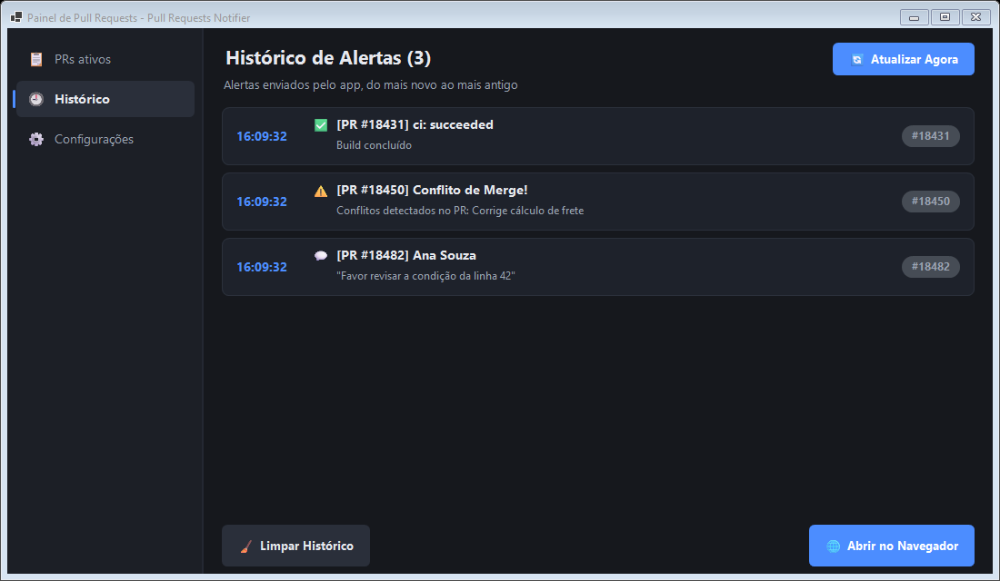

## Referência de todas as opções

A janela de Configurações tem quatro abas. No rodapé:

- **Salvar e Monitorar**: grava tudo e **reinicia o monitoramento** já com as novas opções.
- **Cancelar**: descarta as alterações. Qualquer pré-visualização de estilo, tema ou idioma é desfeita.

No canto superior direito há dois atalhos: **Tema: Claro/Escuro** e **Idioma: PT/EN**, que alternam o visual e o idioma na hora (só valem de verdade depois de **Salvar**).

### Aba Conexão

Os dados para falar com o Azure DevOps.

  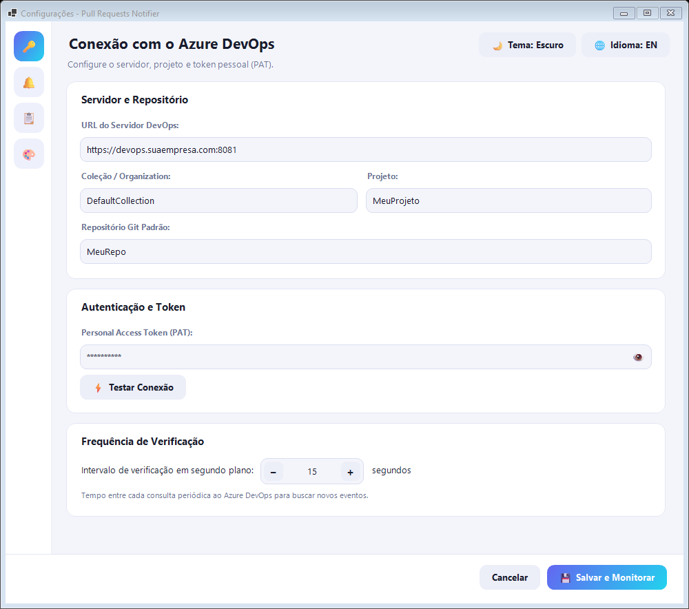

| Opção | O que faz | Padrão |
|---|---|---|
| **URL do Servidor DevOps** | Endereço base do servidor, sem caminho. Ex.: `https://devops.exemplo.com:8081` (Server) ou `https://dev.azure.com` (nuvem). | vazio |
| **Coleção / Organization** | No Azure DevOps Server, o nome da coleção (ex.: `DefaultCollection`). Na nuvem, o nome da organização. | vazio |
| **Projeto** | Nome do projeto. Nomes com espaço funcionam. | vazio |
| **Repositório Git Padrão** | Nome (ou ID) do repositório Git a monitorar. O app monitora **um repositório** por vez. | vazio |
| **Personal Access Token (PAT)** | Seu token de acesso. O ícone de olho à direita do campo mostra/oculta o texto digitado. | vazio |
| **Testar Conexão** | Autentica no servidor e mostra "Conectado: seu nome!" ou o erro. Use antes de salvar. | n/a |
| **Intervalo de verificação em segundo plano** | De quanto em quanto tempo o app consulta o Azure DevOps. Vai de 10 a 600 segundos. Intervalos menores avisam mais rápido, mas fazem mais requisições ao servidor. | 15 s |

### Aba Notificações

Como os alertas se comportam na tela.

  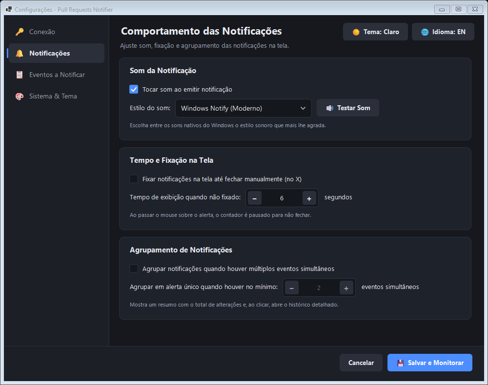

**Som da Notificação**

| Opção | O que faz | Padrão |
|---|---|---|
| **Tocar som ao emitir notificação** | Liga/desliga o som. Quando vários alertas chegam juntos, toca um som só. | ligado |
| **Estilo do som** | Escolha entre 10 sons nativos do Windows: Windows Notify, Asterisk, Chimes, Chord, Ding, Balloon, Tada, Notify Classic, Exclamation e Beep. | Windows Notify |
| **Testar Som** | Toca o som escolhido para você ouvir. | n/a |

**Tempo e Fixação na Tela**

| Opção | O que faz | Padrão |
|---|---|---|
| **Fixar notificações na tela até fechar manualmente (no X)** | O alerta só some quando você clica no **X**. Alertas fixados ganham o selo **FIXADO**. | desligado |
| **Tempo de exibição quando não fixado** | Por quantos segundos o alerta fica visível antes de sumir (2 a 60). Fica desativado se a fixação estiver ligada. | 6 s |

> Enquanto o mouse estiver **sobre** o alerta, a contagem para e ele não fecha sozinho.

**Agrupamento de Notificações**

| Opção | O que faz | Padrão |
|---|---|---|
| **Agrupar notificações quando houver múltiplos eventos simultâneos** | Se uma mesma rodada de verificação gerar vários eventos, o app mostra **um alerta-resumo** em vez de vários. Clicar nele abre o PR (se for um só) ou a lista de PRs. Todos os eventos continuam no histórico. | desligado |
| **Agrupar em alerta único quando houver no mínimo** | A partir de quantos eventos simultâneos o resumo passa a ser usado (2 a 20). Fica desativado se o agrupamento estiver desligado. | 2 |

### Aba Eventos a Notificar

Escolha o que merece um alerta. **Cada caixa liga ou desliga um tipo de evento.** Por padrão, todas vêm marcadas.

  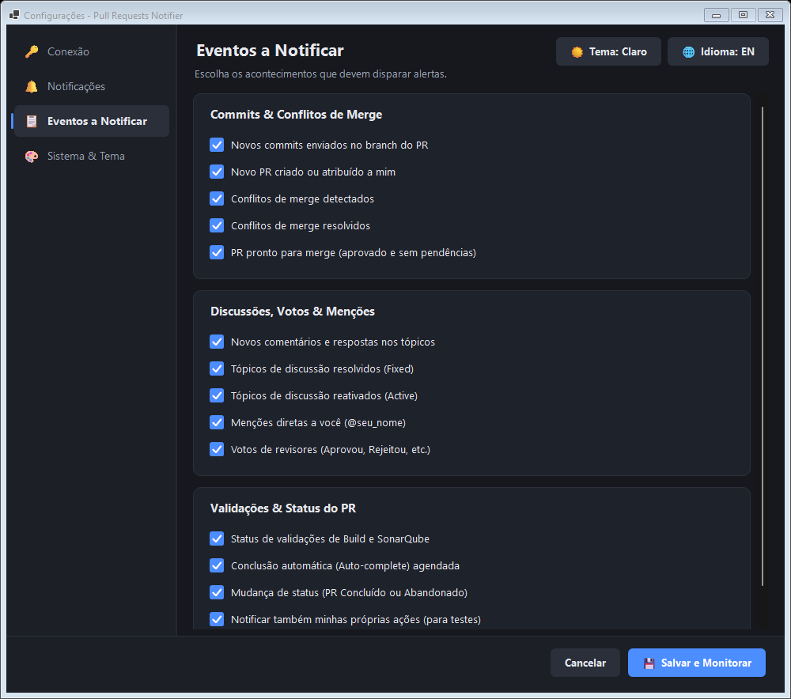

**Commits & Conflitos de Merge**

| Opção | Quando avisa |
|---|---|
| **Novos commits enviados no branch do PR** | Alguém fez `push` no branch de origem do PR. |
| **Novo PR criado ou atribuído a mim** | Aparece um PR novo no seu escopo (criado por você ou em que você virou revisor) depois que o app já estava rodando. PRs em rascunho (*draft*) são ignorados. |
| **Conflitos de merge detectados** | O PR passou a ter conflitos. |
| **Conflitos de merge resolvidos** | O PR tinha conflitos e agora está sem eles. |
| **PR pronto para merge (aprovado e sem pendências)** | O PR tem pelo menos uma aprovação (ou aprovação com sugestões), nenhum revisor pedindo mudanças ou rejeitando, sem conflitos e sem validações falhas. Avisa **uma vez**, quando passa a estar pronto. |

**Discussões, Votos & Menções**

| Opção | Quando avisa |
|---|---|
| **Novos comentários e respostas nos tópicos** | Chega um comentário novo, inclusive resposta em um tópico que já existia. Comentários automáticos do sistema são ignorados. |
| **Tópicos de discussão resolvidos (Fixed)** | Um tópico foi marcado como resolvido. |
| **Tópicos de discussão reativados (Active)** | Um tópico resolvido foi reaberto. |
| **Menções diretas a você (@seu_nome)** | Alguém te mencionou em um comentário. Esse alerta substitui o de comentário comum. |
| **Votos de revisores (Aprovou, Rejeitou, etc.)** | Um revisor votou: *aprovou*, *aprovou com sugestões*, *está aguardando o autor* ou *rejeitou*. |

**Validações & Status do PR**

| Opção | Quando avisa |
|---|---|
| **Status de validações de Build e SonarQube** | Uma validação do PR mudou de estado (ex.: `pending` → `succeeded` ou `failed`). O ícone indica o resultado: ✅ passou, ❌ falhou, ⚙️ em andamento. |
| **Conclusão automática (Auto-complete) agendada** | Alguém agendou o *auto-complete* do PR. |
| **Mudança de status (PR Concluído ou Abandonado)** | Reservada para uma versão futura: a caixa existe, mas **ainda não gera alertas**. |
| **Notificar também minhas próprias ações (para testes)** | Se **desmarcada**, o app ignora o que **você mesmo** fez (seus comentários, votos, pushes e PRs). Útil para testar o app sozinho com uma segunda conta. |

### Aba Sistema & Tema

Aparência, idioma, escopo e inicialização.

  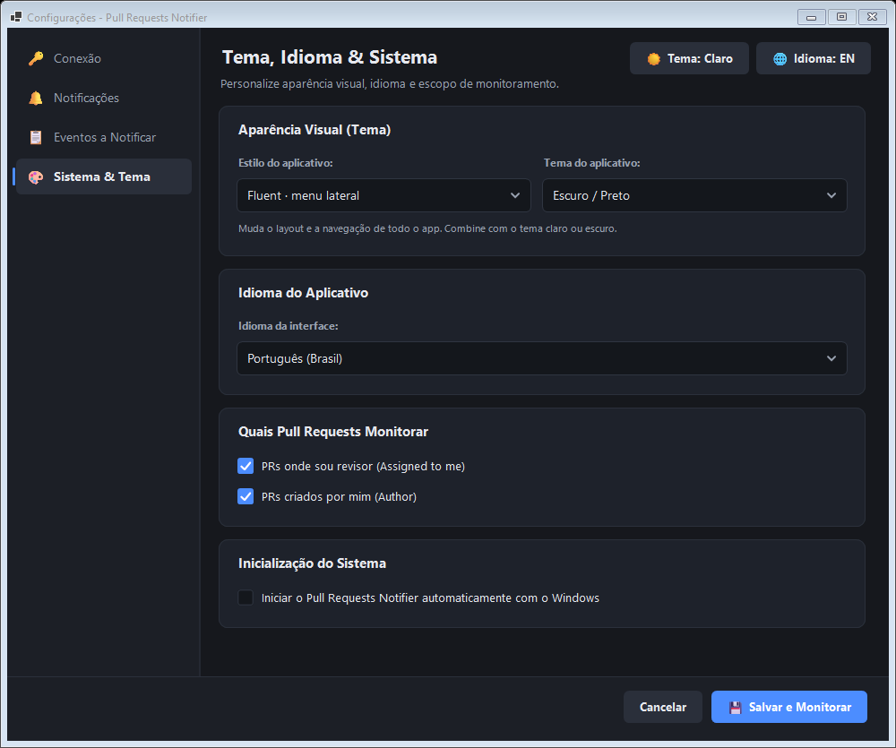

| Opção | O que faz | Padrão |
|---|---|---|
| **Estilo do aplicativo** | Escolhe o layout de **todo** o app: Fluent (menu lateral), Limpo (abas no topo) ou Gradiente (barra de ícones). Veja [Estilos visuais](#estilos-visuais). A mudança aparece **na hora**, como pré-visualização. | Fluent |
| **Tema do aplicativo** | Claro ou Escuro. Combina com qualquer estilo. | Escuro |
| **Idioma da interface** | Português (Brasil) ou English (United States). | Português |
| **PRs onde sou revisor (Assigned to me)** | Monitora os PRs em que você foi incluído como revisor. | ligado |
| **PRs criados por mim (Author)** | Monitora os PRs que você abriu. | ligado |
| **Iniciar o Pull Requests Notifier automaticamente com o Windows** | Abre o app sozinho quando você entra no Windows. | desligado |

> Desmarcar **as duas** opções de escopo faz o app não monitorar nenhum PR.

## Estilos visuais

Em **Configurações → Sistema & Tema → Estilo** você escolhe entre três visuais. Cada um tem versão **clara** e **escura**. A **navegação muda de lugar** conforme o estilo, e as mesmas funções continuam disponíveis em todos.

| Estilo | Navegação | Personalidade |
|---|---|---|
| **Fluent** | Menu lateral com ícone e texto | Parecido com o Windows 11: cartões suaves, cantos arredondados, azul de destaque. |
| **Limpo** | Abas em formato de pílula no topo | Muito espaço em branco, visual leve e direto. |
| **Gradiente** | Barra estreita de ícones à esquerda (Configurações no rodapé dela) | Mais ousado: cantos bem arredondados e destaque em gradiente azul-ciano. |

### Painel de PRs

| Escuro | Claro |
|:--:|:--:|
|  **Fluent**, menu lateral | 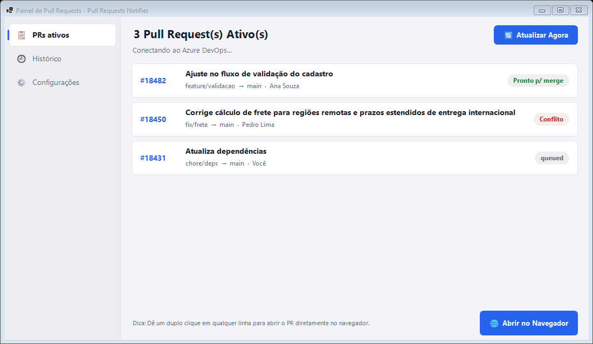 **Fluent**, menu lateral |
| 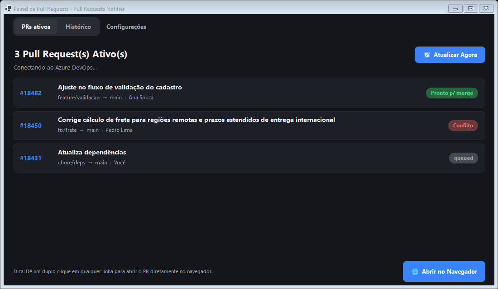 **Limpo**, abas no topo | 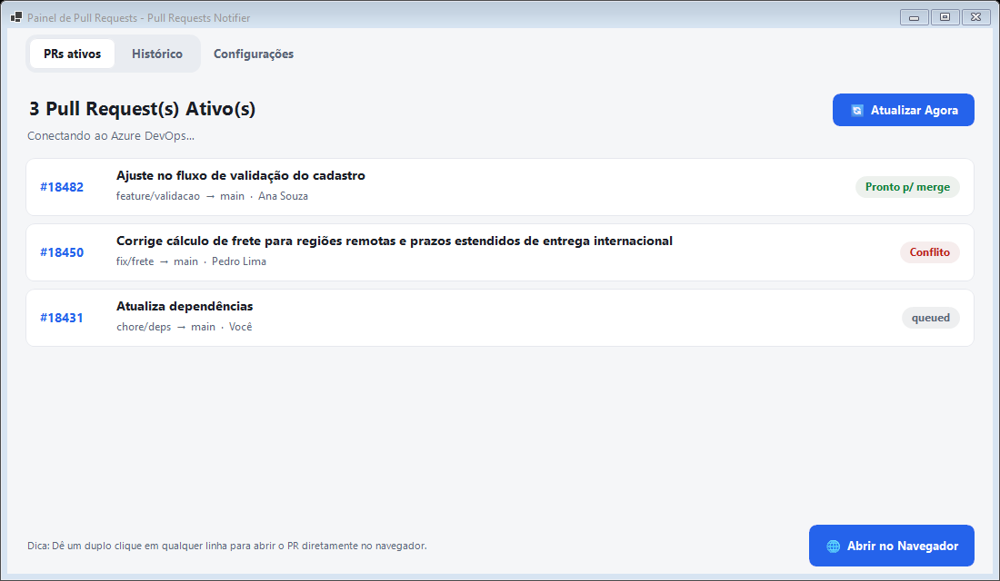 **Limpo**, abas no topo |
| 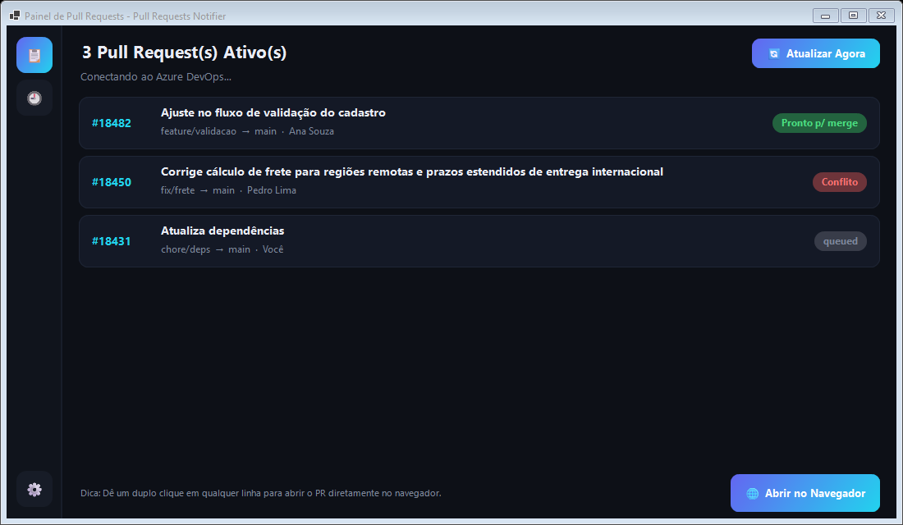 **Gradiente**, barra de ícones | 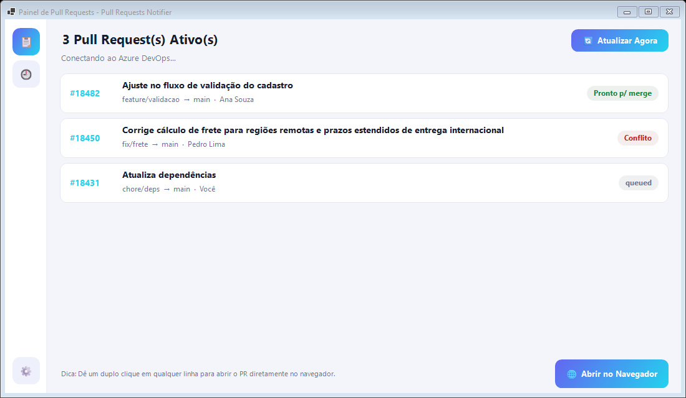 **Gradiente**, barra de ícones |

### Janela de Configurações

| Escuro | Claro |
|:--:|:--:|
|  | 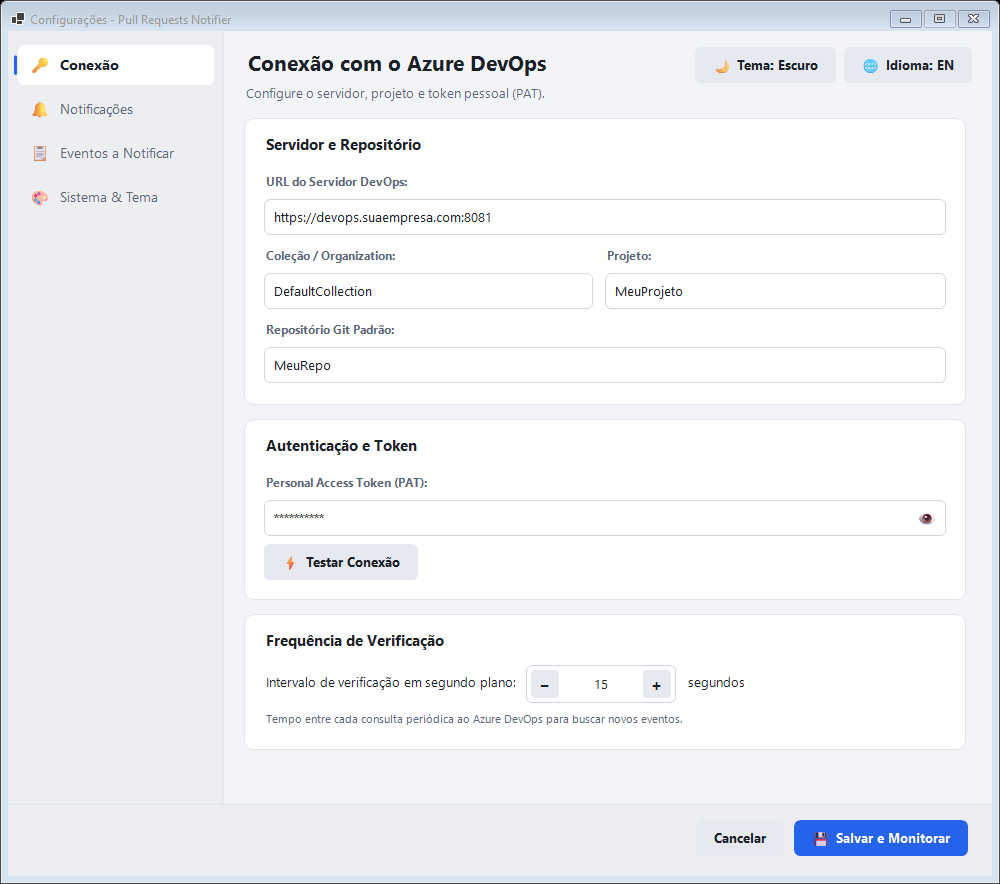 |
| 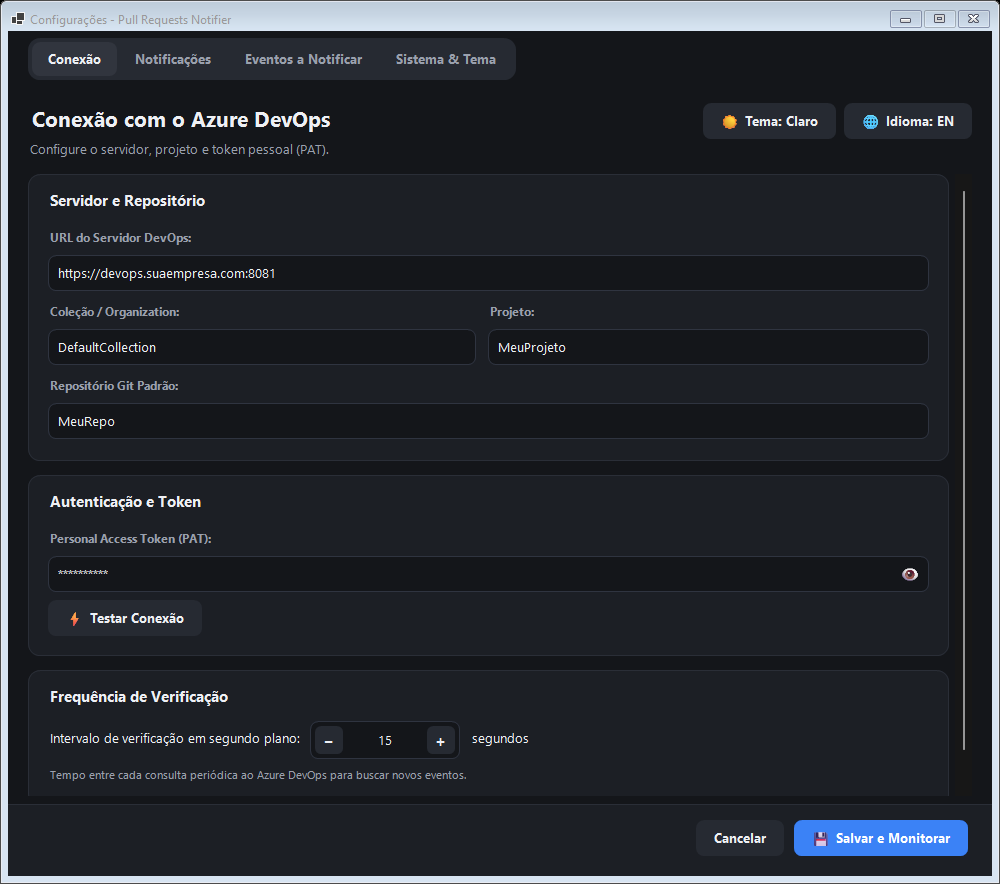 | 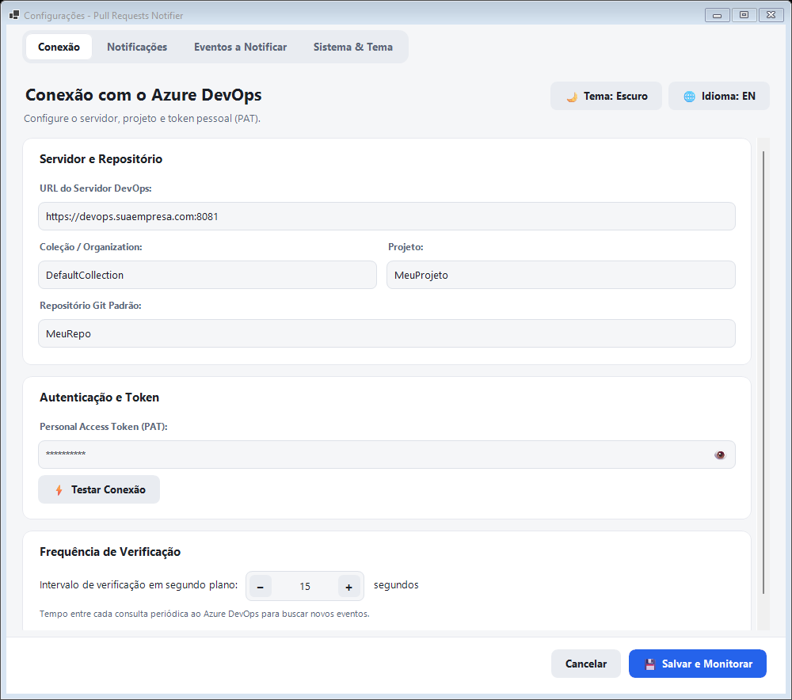 |
| 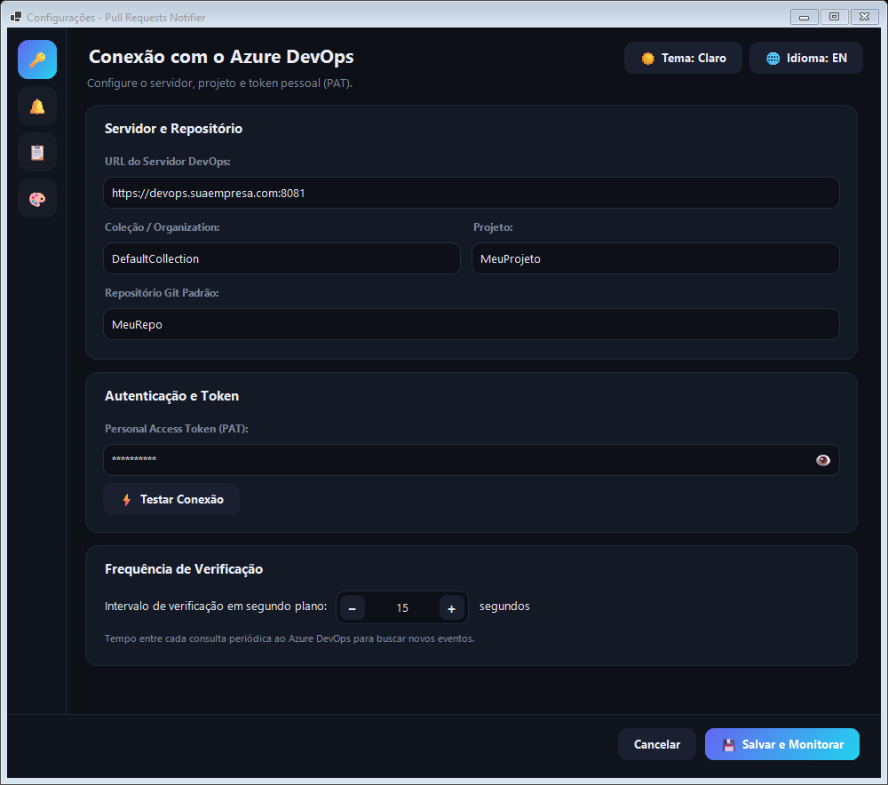 |  |

### Alertas na tela

Os alertas também seguem o estilo: barra lateral colorida no Fluent, cartão limpo no Limpo e faixa em gradiente no topo no Gradiente. A cor do ícone indica o tipo do evento (roxo para comentários, vermelho para conflitos e falhas, verde para aprovações e sucesso, âmbar para novos commits e atualizações, azul para PR novo).

| Escuro | Claro |
|:--:|:--:|
| 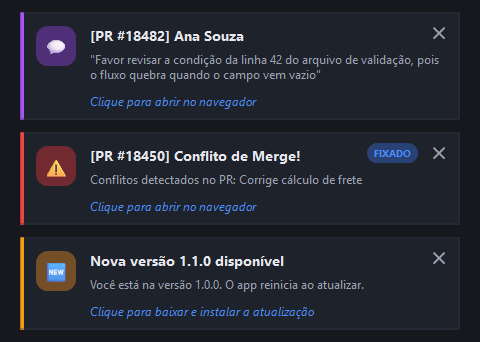 | 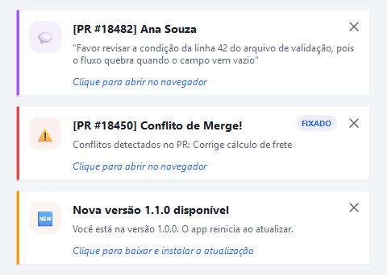 |
| 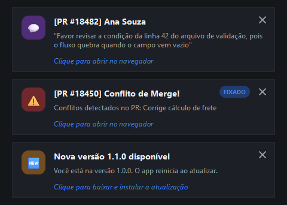 | 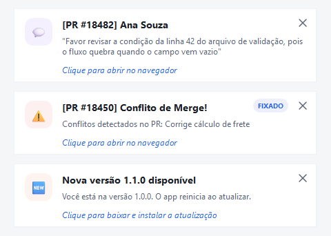 |
| 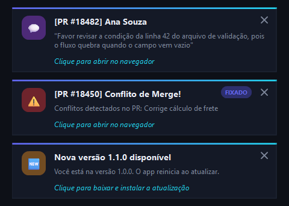 | 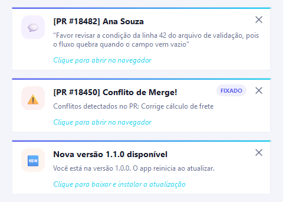 |

## Como são os alertas na tela

- Aparecem no **canto inferior direito**, na tela onde está a barra de tarefas, e **empilham** de baixo para cima. No máximo **4** ficam visíveis ao mesmo tempo; ao chegar o quinto, o mais antigo sai (tudo continua no histórico).
- **Não roubam o foco**: você continua digitando onde estava.
- **Clicar** no alerta abre o PR no navegador (ou o histórico, no caso de resumos de vários PRs). Clicar no **X** só fecha.
- O mouse **sobre** o alerta pausa a contagem para fechar.
- Se você mudar a resolução ou conectar/desconectar um monitor, os alertas se reposicionam sozinhos.
- Além do alerta na tela, o Windows também mostra um balão do ícone da bandeja. Clicar nele faz o mesmo que clicar no alerta.

## Atualizações automáticas

- O app procura versão nova **30 segundos depois de abrir** e depois **a cada 6 horas**, consultando as versões publicadas neste repositório.
- Quando há uma, aparece uma notificação **"Nova versão X disponível"**. Clique nela: o app baixa, reinicia e já abre atualizado.
- Você também pode procurar manualmente: **bandeja → Verificar atualizações**.
- Só **instalações feitas pelo `Setup.exe`** se atualizam. Quem roda o executável solto (sem instalar) vê a mensagem "Atualização indisponível".
- Suas configurações e o PAT **não são apagados** na atualização.

## Onde ficam seus dados e segurança

| O quê | Onde |
|---|---|
| Configurações | `%APPDATA%\PullRequestsNotifier\settings.json` |
| Log (para diagnóstico) | `%APPDATA%\PullRequestsNotifier\app.log` (rotação automática, no máximo ~2 MB) |
| Histórico de alertas | Somente na memória; é zerado ao fechar o app |

**Segurança**

- O **PAT é gravado criptografado** com a proteção de dados do Windows (DPAPI) e só pode ser lido pelo **seu usuário do Windows**, nesta máquina. Copiar o arquivo para outro computador ou usuário não revela o token (você terá que digitá-lo de novo).
- O app é **somente leitura**: só faz consultas ao Azure DevOps.
- Ele só se comunica com **dois destinos**: o seu servidor Azure DevOps e o GitHub (para procurar atualizações). **Não envia telemetria** nem dados de uso.
- Use um PAT com o **menor escopo possível** (**Code → Read**) e com validade curta.

## Solução de problemas

**"Falha ao autenticar. Verifique URL e PAT."**
Confira: (1) a URL do servidor está só com o endereço base, sem `/_git` nem nome de projeto; (2) o nome da **coleção** (ou da organização) está certo; (3) o PAT não expirou e tem **Code → Read**; (4) você está na rede/VPN que alcança o servidor.

**"Erro de rede" / "Erro do servidor: HTTP ..." no menu da bandeja**
É um problema de conexão (VPN caída, servidor fora do ar). O app tenta de novo sozinho a cada ciclo e **não perde** o estado anterior. Quando a conexão voltar, volta ao normal.

**A lista de PRs está vazia**
Verifique o **nome do repositório** (aba Conexão) e se pelo menos uma opção de escopo está marcada (aba Sistema & Tema). Só aparecem PRs **ativos** em que você é **autor** ou **revisor**.

**Não recebo notificações**
- Lembre que a **primeira leitura** depois de abrir o app só serve de referência: os alertas vêm das mudanças seguintes.
- Confira se o tipo de evento está marcado na aba **Eventos a Notificar**.
- Se **Notificar também minhas próprias ações** estiver desmarcado, o que você mesmo faz não gera alerta.
- Use **bandeja → Testar Notificações na Tela** para ver se os alertas aparecem com as suas configurações.

**O app não abriu / diz que já está em execução**
Ele roda **uma instância por vez**. O ícone está na bandeja; clique na setinha **^** perto do relógio para ver os ícones ocultos.

**O ícone sumiu da bandeja**
Abra o app de novo pelo Menu Iniciar. Se quiser que ele abra sozinho, ligue **Iniciar com o Windows** na aba Sistema & Tema.

**Quero começar do zero**
Feche o app (bandeja → Sair) e apague a pasta `%APPDATA%\PullRequestsNotifier`. Ao abrir de novo, ele pede as configurações como na primeira vez.

**Aparece "Atualização indisponível"**
Você está rodando uma versão que não foi instalada pelo `Setup.exe`. Baixe o instalador na página de [Releases](../../releases/latest).

## Desinstalar

1. Abra **Configurações do Windows → Aplicativos → Aplicativos instalados**.
2. Procure **Pull Requests Notifier** e clique em **Desinstalar**.
3. (Opcional) Para remover também as suas configurações e o log, apague a pasta `%APPDATA%\PullRequestsNotifier`.

## Limitações conhecidas

- Monitora **um repositório por vez** (o configurado na aba Conexão).
- Funciona por **consulta periódica** (não é tempo real): o atraso máximo é o intervalo configurado.
- Os alertas só aparecem **enquanto o app está aberto**. Eventos que acontecem com o app fechado não são avisados depois.
- O histórico de alertas fica só na memória (últimos 200) e é zerado ao fechar.
- A opção **Mudança de status (PR Concluído ou Abandonado)** ainda não gera alertas.
- Somente Windows.

---

Dúvidas ou sugestões? Abra uma *issue* neste repositório.
